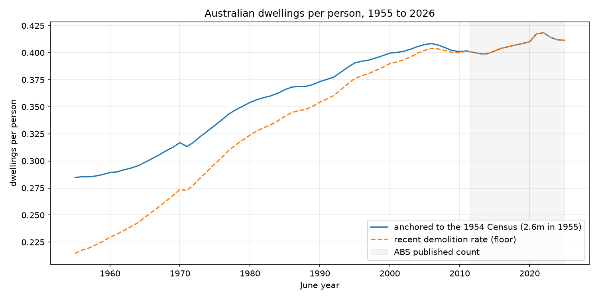
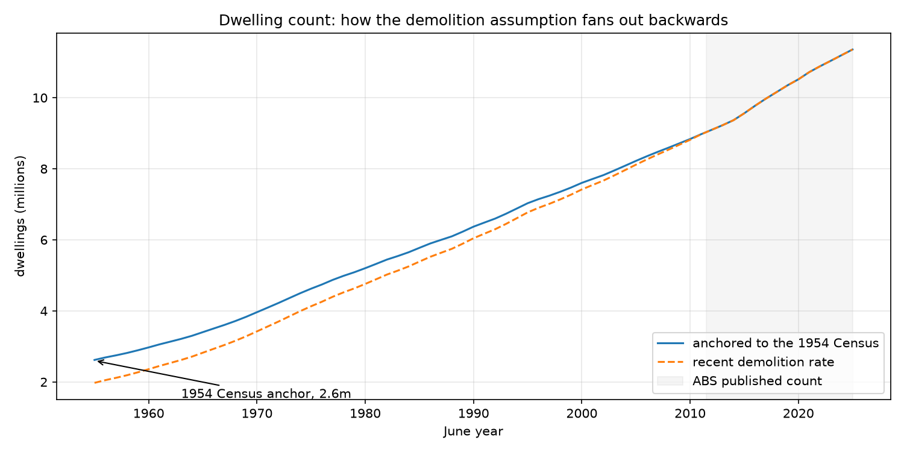

# housing-stock-per-person

Australian dwellings per person, quarterly, 1955 to 2026. The ABS publishes the dwelling count only from 2011, so everything earlier is reconstructed here, and the reconstruction rests on one free assumption, stated in full below.

The question it answers is whether the housing stock has kept pace with the population over seven decades.



## What it shows

| June | Dwellings | Population | Per person | Per person (floor) |
| ---- | --------- | ---------- | ---------- | ------------------ |
| 1955 | 2.62m     | 9,199,729  | 0.285      | 0.215              |
| 1960 | 2.97m     | 10,275,020 | 0.289      | 0.230              |
| 1970 | 3.96m     | 12,507,349 | 0.317      | 0.274              |
| 1980 | 5.20m     | 14,695,356 | 0.354      | 0.324              |
| 1990 | 6.37m     | 17,065,128 | 0.373      | 0.354              |
| 1996 | 7.15m     | 18,224,767 | 0.392      | 0.379              |
| 2000 | 7.60m     | 19,028,802 | 0.400      | 0.390              |
| 2010 | 8.84m     | 22,031,750 | 0.401      | 0.400              |
| 2020 | 10.52m    | 25,649,248 | 0.410      | 0.410              |
| 2025 | 11.36m    | 27,601,739 | 0.412      | 0.412              |

The stock per person climbed from 0.28 in 1955 to about 0.40 by 2000, then went broadly sideways for twenty years and has slipped since 2021. The floor column is the pessimistic end of the range, explained under assumptions.

## Sources

All free, keyless, no registration.

| Series                          | ABS product                                | Coverage       |
| ------------------------------- | ------------------------------------------ | -------------- |
| Number of residential dwellings | `RES_DWELL_ST`, measure 4, Australia       | 2011-Q3 onward |
| Dwelling units completed        | `BUILDING_ACTIVITY`, measure M7, Australia | 1955-Q1 onward |
| Population at June              | Historical population, 2021, HPDC1 Table 2 | 1901 to 2021   |
| Population at June              | `ERP_Q`                                    | 1981 to 2026   |

## Method

1. Anchor on the published dwelling count at 2011-Q3.
2. Walk it backwards a quarter at a time: `stock(t-1) = stock(t) - completions(t) + demolitions(t)`.
3. Completions come from the ABS. Demolitions are not published as a count, so they are modelled.
4. Divide by population at June.

Everything before 2011-Q3 is therefore reconstructed, and it inherits the choices below.

## Assumptions

**Demolitions are a constant share of the stock.** The ABS publishes the value of demolition work but not the number of dwellings demolished, so the count cannot be read off directly. The overlap where both series exist, 2011-Q3 to 2026-Q2, implies about 11,000 demolitions a year, or 0.11% of the stock. Applied unchanged back to 1955 it produces 1.95m dwellings, well below the roughly 2.6m the 1954 Census counted, which says the rate was higher in the past.

**The high case is anchored to the 1954 Census.** The solid line calibrates the demolition rate so the count in 1955-Q1 lands on 2.6m, putting the historic rate near 0.30% a year, about three times the recent one. That anchor came from memory rather than a source in this repo and should be checked against the actual 1954 figure. If the true stock was 2.4m or 2.8m the whole early series shifts by about 8% in the same direction.

**Completions and the stock measure the same thing.** The completions series counts new residential dwelling units; the count is estimated residential dwellings. Both cover all sectors and both are new work, so alterations that create dwellings are a small residual rather than a double count.

**Population is spliced.** The historical series runs to 2021 and ERP takes over from 2022. Both are ABS estimates and they agree at the join, but it is a splice all the same.

**The concept shifts at 2011.** A Census counts occupied private dwellings; `RES_DWELL_ST` is estimated residential dwellings, which includes unoccupied stock. Comparing the two directly introduces that difference, so this series stays inside the `RES_DWELL_ST` definition and uses the Census only as an outside check on the level.



The second chart is the assumption made visible. The two demolition rates agree where the ABS count exists, from 2011 onward in the shaded band, and fan out going back, reaching about 25% apart by 1955. Where they disagree, the truth is somewhere between them.

## Caveats

- Levels before 2011-Q3 are estimates. The spread is roughly 25% at 1955, about 5% by 1990, and zero from 2011-Q3 where the ABS count begins.
- One historic Census count, 1991 or 1996 for instance, would pin the demolition path and make the early series a fit rather than a guess. The ABS's older Census volumes hold those counts but they are PDFs, not data.

## Files

```
dwellings_per_person.ipynb   the analysis, runs end to end
dwellings-per-person.csv     output, quarterly, 286 rows
img/                         the two charts used above
pyproject.toml               dependencies
.python-version              interpreter pin
```

## Running it

Requires [uv](https://docs.astral.sh/uv/). The notebook is the whole analysis.

```bash
uv sync
uv run jupyter lab dwellings_per_person.ipynb
```

To execute it headless and regenerate the CSV and charts:

```bash
uv run jupyter nbconvert --to notebook --execute --inplace dwellings_per_person.ipynb
```
